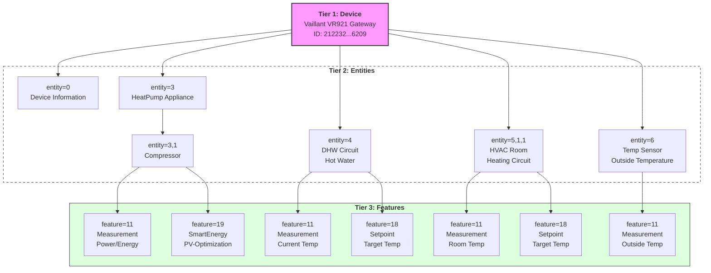

# Vaillant VR921 – SHIP/SPINE Python Client

> **Note**: This project is a fork of  [markusschultheis/Vaillant-VR921](https://github.com/markusschultheis/Vaillant-VR921). Special thanks to the author for the original implementation.

## Overview
This project contains a Python script ([connect_vr921.py](connect_vr921.py)) that communicates with a Vaillant VR921/EEBUS gateway via **SHIP** (TLS WebSocket) and exchanges **SPINE** datagrams. It enables integration with **Home Assistant** through MQTT, allowing you to monitor and automate your heat pump system.

### Key Capabilities

The script can:
- Generate and reuse a **client certificate** (stable identity via SKI)
- Announce itself and discover the VR921 via **mDNS** (`_ship._tcp.local.`)
- Establish a **wss://…/ship/** connection and perform the **SHIP handshake**
- Respond to gateway-initiated **SPINE READ/CALL** messages (required for interoperability)
- Discover and subscribe to **Measurement** servers to read telemetry data
- Query additional server types: **SmartEnergyManagementPs**, **Setpoint**, **DeviceInfo**, **ElectricalConnection**, **LoadControl**, **DeviceConfiguration**, **DeviceDiagnosis**, **HVAC**
- **Publish measurements via MQTT with Home Assistant Discovery** for seamless Home Assistant integration
- Currently fetches **power/energy data** with potential for extension to additional entities. Check out the original repository for how to do this - I'm only interested in power so I can calculate energy.

### Home Assistant Integration

MQTT integration makes this script a solution for sending Vaillant EEBUS readings into **Home Assistant**. Once configured, the script will:
- Automatically discover entities in Home Assistant via MQTT Discovery
- Publish real-time power measurements from your heat pump
- Allow future extension to support additional entities such as:
  - Hot water temperature
  - Room/space heating temperatures
  - Setpoint temperatures
  - And other available SPINE entities

### Key Terms
- **SHIP**: transport/session protocol over TLS WebSocket.
- **SPINE**: application data model/protocol transported inside SHIP DATA frames.
- **SKI**: X.509 *Subject Key Identifier* (hex) used as a stable client identity.
- **EEBUS JSON / array-wrapped JSON**: some stacks encode JSON as list-of-single-key objects.

### Limitations & Device Compatibility

**EEBUS on VR921**: The VR921 has known EEBUS limitations, particularly around connection locking and concurrency. However, this script seems to be relatively stable in production use, managing these constraints effectively.

**Device Compatibility**: While tested on the VR921, the script *should* theoretically work on the VR940f (not tested). Other EEBUS-enabled Vaillant devices may also be compatible with appropriate modifications.

---

## Setup

### Prerequisites
- Python 3.10+ recommended
- Network access to the VR921 on the same LAN (mDNS must work)

### Installation
```bash
python3 -m venv .venv
source .venv/bin/activate
pip install -r requirements.txt
```

### Optional: MQTT / Home Assistant
- If you want MQTT: `paho-mqtt` is included in [requirements.txt](requirements.txt).
- Broker credentials are stored in [mqtt_secrets.py](mqtt_secrets.py) (ignored by default via `.gitignore`).
- VR921 does not seem to return energy measurements in EEBUS (VR940f may but not tested). You can get a decent approximation in Home Assistant by creating an integral helper on the power reading using left-side Riemann integration and defaulting to fill in new readings every 5 minutes if not supplied.

### Running on a Raspberry Pi / server (as a daemon)
You can run the script continuously on a Raspberry Pi (Raspberry Pi OS) or a Linux server in your LAN – typically via **systemd**.

1) Copy the project e.g. to `/opt/Vaillant-VR921` and create a venv there:
```bash
sudo mkdir -p /opt/Vaillant-VR921
sudo chown -R $USER: /opt/Vaillant-VR921

cd /opt/Vaillant-VR921
python3 -m venv .venv
source .venv/bin/activate
pip install -r requirements.txt
```

2) Optional: put environment variables into an env file (recommended):
`/etc/default/vaillant-vr921`
```bash
# MQTT (optional)
HA_MQTT_HOST=
HA_MQTT_PORT=1883
HA_MQTT_USER=
HA_MQTT_PASSWORD=

# Logging (optional)
SHIP_JSONL=true
SHIP_DISCOVERY_LOG=false
```

3) Create a systemd unit: `/etc/systemd/system/vaillant-vr921.service`
```ini
[Unit]
Description=Vaillant VR921 SHIP/SPINE client
Wants=network-online.target
After=network-online.target

[Service]
Type=simple
User=pi
WorkingDirectory=/opt/Vaillant-VR921
EnvironmentFile=-/etc/default/vaillant-vr921
ExecStart=/opt/Vaillant-VR921/.venv/bin/python /opt/Vaillant-VR921/connect_vr921.py
Restart=on-failure
RestartSec=5

[Install]
WantedBy=multi-user.target
```

4) Enable + start the service:
```bash
sudo systemctl daemon-reload
sudo systemctl enable --now vaillant-vr921.service
sudo systemctl status vaillant-vr921.service
```

View logs:
```bash
journalctl -u vaillant-vr921.service -f
```

---

## Configuration

### MQTT/Home Assistant (optional)
You can configure MQTT in two ways:
1) Fill in [mqtt_secrets.py](mqtt_secrets.py)
2) or set environment variables (they override `mqtt_secrets.py`)

Relevant variables:
- `HA_MQTT_HOST`, `HA_MQTT_PORT`, `HA_MQTT_USER`, `HA_MQTT_PASSWORD`
- `HA_MQTT_PREFIX` (default `homeassistant`)
- `HA_MQTT_STATE_PREFIX` (default `ship`)
- `SHIP_MQTT_DEBUG` (True/False)
- `SHIP_MQTT_RETAIN_STATE` (True/False)

Also:
- `HA_DEVICE_ID` / `HA_DEVICE_NAME` for Home Assistant device naming

### Logging/Output
- `SHIP_JSONL=true` prints measurements as JSONL (one line per update).
- `SHIP_DISCOVERY_LOG=true` prints extra discovery details.

---

## Script Overview (Functions & Classes)

### 1) Utilities
- `MsgCounter`
  - Purpose: async-safe counter for SPINE `msgCounter`.

- `_env_str`, `_env_int`, `_env_bool`
  - Purpose: read environment variables with safe defaults.

- `_slug`
  - Purpose: build MQTT/HA-safe object ids.

- `_unit_to_ha`, `_guess_ha_metadata`, `_friendly_sensor_name`
  - Purpose: best-effort mapping from SPINE scope/unit to HA metadata and names.

### 2) MQTT / Home Assistant
- `HAMqttPublisher`
  - Purpose: optional MQTT publisher with Home Assistant Discovery.
  - Enabled: if `HA_MQTT_HOST` is configured (or provided in `mqtt_secrets.py`).
  - Key methods:
    - `connect()`: connects and sets an LWT availability.
    - `ensure_discovery(...)`: publishes discovery config once per sensor.
    - `publish_state(...)`: publishes sensor values.
    - `close()`: marks offline and disconnects.

### 3) EEBUS JSON Conversion
- `json_into_eebus_json(...)`
  - Purpose: convert normal JSON → EEBUS array-wrapped JSON.

- `json_text_into_eebus_json(...)`
  - Purpose: same, starting from JSON text while preserving field order.

- `json_from_eebus_json(...)`
  - Purpose: convert EEBUS array-wrapped JSON → normal JSON.

### 4) SPINE Parsing/Reply Helpers
- `_first_cmd(...)`
  - Purpose: extract the first `cmd` object regardless of nesting.

- `_parse_spine_datagram(...)`
  - Purpose: extract `(header, first_cmd)` from a decoded SHIP DATA message.

- `_make_spine_reply_addresses(...)`
  - Purpose: compute correct source/destination for replies/results.
  - Interop: does not always force-inject `device`.

### 5) Certificate / Identity
- `get_or_create_certificate()`
  - Purpose: manage `cert.pem`/`key.pem` and return the SKI hex.

### 6) mDNS
- `MDNSHandler`
  - Purpose: listen for `_ship._tcp.local.` and keep the VR921 candidate in `target_info`.

### 7) SHIP Send Helpers
- `send_ship_json(...)`
  - Purpose: send SHIP CONTROL frames (0x01).

- `send_ship_data(...)`
  - Purpose: send SHIP DATA frames (0x02) using a ship-go compatible placeholder approach.

- `send_access_methods(...)`
  - Purpose: send SHIP `accessMethods` with local id.

### 8) Local Discovery Replies
- `build_local_detailed_discovery(...)`
  - Purpose: minimal `NodeManagementDetailedDiscoveryData` reply.

- `build_device_classification_manufacturer_data(...)`, `build_device_classification_user_data(...)`
  - Purpose: minimal DeviceClassification replies.

### 9) SPINE Send/Handle
- `_spine_addr(...)`
  - Purpose: convenience SPINE address builder.

- `send_spine_read(...)`, `send_spine_call(...)`
  - Purpose: build + send SPINE read/call datagrams.

- `send_spine_result_ok(...)`
  - Purpose: acknowledge a datagram via cmdClassifier=`result` (errorNumber 0).

- `handle_spine_read(...)`
  - Purpose: minimal `cmdClassifier=read` handling and replies.

### 10) Remote Discovery / Measurement
- `request_remote_detailed_discovery(...)`
  - Purpose: request `nodeManagementDetailedDiscoveryData` from the VR921.

- `request_remote_node_management_use_case_data(...)`
  - Purpose: request `nodeManagementUseCaseData`.

- `_extract_entities(...)`, `_extract_measurement_servers(...)`, `_extract_setpoint_servers(...)`, `_extract_device_info_servers(...)`, `_extract_smart_energy_servers(...)`, `_extract_electrical_connection_servers(...)`, `_extract_loadcontrol_servers(...)`, `_extract_deviceconfiguration_servers(...)`, `_extract_devicediagnosis_servers(...)`, `_extract_hvac_servers(...)`
  - Purpose: parse discovery to list entities and various server types.

- `subscribe_remote_measurement(...)`
  - Purpose: subscription via NodeManagementSubscriptionRequestCall.

- `request_remote_measurement_once(...)`
  - Purpose: read `measurementDescriptionListData` and `measurementListData` once.

- `parse_measurement_description(...)`, `parse_measurement_list(...)`
  - Purpose: parse reply/notify payloads into structured updates.

### 11) SHIP Handshake + Main
- `perform_ship_handshake(...)`
  - Purpose: implements SHIP handshake state machine:
    - CMI init
    - HELLO (pending/ready)
    - protocol negotiation
    - PIN (only none)
    - access methods exchange

- `main()`
  - Purpose: orchestrates everything end-to-end.

---

## Running the Script

```bash
python3 connect_vr921.py
```

While `HELLO phase=pending`, confirm Trust/Pairing in the myVAILLANT app.

---

## Device Structure



---

## License

This project is licensed under the **MIT License**. See the [LICENSE](LICENSE) file for details.

You are free to use, modify, and distribute this software for any purpose, commercial or otherwise, provided you include the original copyright notice and license text.

The original EEBUS/SHIP implementation by Markus Schultheis is also made available under the MIT License.
